# 🛡️ Awesome Policy & Compliance Management

  <b>A curated index of enterprise SaaS platforms, open-source GRC engines, continuous compliance automations, and policy-as-code frameworks.</b>
   
  Covering SOC 2 • ISO/IEC 27001 • HIPAA • GDPR • FedRAMP • NIST CSF • PCI DSS • NIS2 • DORA • SOX

---

## 📑 Table of Contents

- [📌 Introduction & Overview](#-introduction--overview)
- [📊 Sector Overview & Market Dynamics](#-sector-overview--market-dynamics)
- [☁️ SaaS & Enterprise Compliance Platforms](#️-saas--enterprise-compliance-platforms)
- [💻 Open-Source GRC & Compliance Tools](#-open-source-grc--compliance-tools)
- [🎯 Frameworks & Standards Index](#-frameworks--standards-index)
- [🤝 How to Contribute](#-how-to-contribute)
- [💖 Support & Community](#-support--community)
- [⭐ Star History](#-star-history)
- [⚖️ Disclaimer](#️-disclaimer)

---

## 📌 Introduction & Overview

**Policy & Compliance Management** involves continuous orchestration of organizational governance, internal controls, regulatory mandates, and automated audit evidence gathering. Modern systems bridge the gap between regulatory authority documents (such as NIST SP 800-53, ISO 27001, SOC 2 Trust Services Criteria, and GDPR) and real-time IT/cloud operational evidence.

This directory tracks the industry leaders across:
- **Continuous Compliance Automation (CCA)**: Automated testing of cloud infrastructure (AWS, Azure, GCP, SaaS) against security and privacy controls.
- **Integrated Risk Management (IRM / GRC)**: Enterprise policy lifecycles, risk registers, control attestation, and internal audit workpaper management.
- **Policy as Code (PaC)**: Declarative, machine-executable policy engines verifying infrastructure-as-code configurations before deployment.

---

## 📊 Sector Overview & Market Dynamics

The global **Governance, Risk, and Compliance (GRC) and Policy Compliance Management** software market is valued at approximately **$43 billion to $54 billion in 2024–2026** and is projected to surpass **$100 billion to $130 billion by 2030**, expanding at a compound annual growth rate (CAGR) of **12.0% to 14.5%**. This rapid expansion is catalyzed by strict regulatory mandates (including the EU AI Act, NIS2 Directive, DORA, SEC Cybersecurity Disclosure Rules, and ISO/IEC 27001:2022 transitions), alongside enterprise cloud transformations and distributed workforce complexities.

The sector exhibits **moderate fragmentation**:
- **Legacy & Enterprise IRM Titans**: Companies such as **ServiceNow, Archer, Workiva, MetricStream, and OneTrust** command large enterprise footprints, driven by deep ERP/ITSM integrations, complex risk modeling, and multi-year procurement cycles.
- **Modern Continuous Compliance Disruptors**: Fast-scaling agile platforms such as **Vanta, Drata, Sprinto, and Hyperproof** dominate high-growth tech startups, mid-market SaaS companies, and vendor ecosystem audits through automated evidence collection and API-first monitoring.
- **Market Structure**: Rather than a single "winner-take-all" outcome, the market splits between high-touch multi-tiered corporate GRC suites and low-friction, developer-friendly continuous automation solutions.

---

## ☁️ SaaS & Enterprise Compliance Platforms

The table below outlines leading commercial platforms, sorted in **descending order by company scale** (Market Capitalization or Valuation & ARR).

| 🏢 Platform | 📈 Company Scale (Valuation / Revenue) | 🏷️ Starting Tier Pricing | 🎁 Free Tier / Trial Limits | 🔍 Core Capabilities & Scope |
| :--- | :--- | :--- | :--- | :--- |
| **[ServiceNow Policy & Compliance](https://www.servicenow.com/)** | **$195B+ Market Cap** $10.03B Annual Rev (NYSE: NOW) | **$10,000 / year** (Entry standalone ~$600–$720/operator/yr; IRM Standard from ~$1,500/operator/yr) | **Free Forever Personal Developer Instance (PDI)** via ServiceNow Developer Program (full platform access; hibernates after 10 days idle, auto-reclaimed after 15 days); 15-day guided enterprise sandbox on request. | Enterprise Integrated Risk Management (IRM) linking authority docs → citations → control objectives → policies. Continuous monitoring indicators auto-generate remediation issues upon control failure. |
| **[OneTrust](https://www.onetrust.com/)** | **$5.3B Valuation** $400M+ ARR (Series C) | **$10,000 / year** (Platform floor minimum; standalone modular add-ons from $400/month billed annually) | **14-day free evaluation trial** on select modules (capped at 3 assessment workflows/templates and 1 domain scan); custom guided sandbox during enterprise sales scoping. | Trust Intelligence platform unifying privacy automation, AI governance, TPRM, third-party vendor tracking, and regulatory intelligence across 14,000+ global brands. |
| **[Workiva](https://www.workiva.com/)** | **$4.8B Market Cap** $638M Annual Rev (NYSE: WK) | **$25,000 / year** (~$2,083/month for foundational audit/compliance reporting module) | **14-day guided proof-of-concept (POC)** sandbox environment with pre-populated internal controls and SEC templates (sales-qualified only; no perpetual free plan). | Unifies SEC financial reporting with ICFR (internal controls over financial reporting) and SOX compliance; data-linking traceability, audit trails, and granular auditor permissions. |
| **[AuditBoard (Optro)](https://www.auditboard.com/)** | **$3.0B+ Valuation** $150M+ ARR (Acquired by Thoma Bravo) | **$30,000 / year** (~$2,500/month for single module like OpsAudit or SOX compliance) | **14-day guided sandbox POC** (limited to 5 user seats with mock audit data and pre-built control test plans; no perpetual free plan). | Comprehensive audit management platform supporting workpaper preparation, SOX testing, internal control evaluations, ESG tracking, and continuous issue tracking. |
| **[Vanta](https://www.vanta.com/)** | **$2.45B Valuation** $140M+ ARR (Series C - Sequoia) | **$7,500 / year** (~$625/month billed annually for Essentials tier: up to 20 employees & 1 framework) | **14-day automated scan trial** (includes automated risk scoring across 1 framework and up to 3 cloud integrations); free startup risk assessment tools. | Automated trust management platform with 1,400+ automated security tests, 400+ integrations, OSCAL FedRAMP exports, custom controls, and AI-powered GRC query assistant. |
| **[Archer](https://www.archerirm.com/)** | **$2.0B+ Valuation** $280M+ Annual Rev (Acquired by Cinven) | **$14,000 / year** (Single scoped department use-case; core enterprise IRM suites begin at ~$55,000/yr) | **30-day hosted partner/sales POC** sandbox environment with pre-loaded regulatory control libraries (sales qualification required; no perpetual free tier). | Enterprise IRM platform with risk registers, continuous compliance mapping (map-once satisfy-many), quantitative exposure modeling, and audit-ready chain of custody. |
| **[Drata](https://drata.com/)** | **$2.0B Valuation** $90M+ ARR (Series C - ICONIQ) | **$7,500 / year** (~$625/month for Foundation startup tier: up to 50 employees & 1 framework) | **14-day interactive guided product sandbox** (limited to 3 cloud infrastructure integrations and 1 compliance framework via sales onboarding; no perpetual free plan). | Continuous compliance automation platform with 85+ integrations, no-code custom workflows, MTTR dashboards for test remediations, and real-time evidence libraries. |
| **[MetricStream](https://www.metricstream.com/)** | **$1.0B+ Valuation** $160M+ Annual Rev (Clearlake Capital) | **$75,000 / year** (Base CyberGRC / Compliance Management enterprise starter package) | **30-day controlled enterprise sandbox POC** with pre-configured regulatory libraries (ISO, NIST, COSO) upon sales qualification (no perpetual free tier). | AI-powered GRC suite recognized across seven Chartis categories; continuous risk sensing, autonomous evidence gathering, multi-jurisdiction compliance mapping, and remediation. |
| **[LogicGate](https://www.logicgate.ai/)** | **$350M+ Valuation** $35M+ ARR ($113M Total Funding) | **$13,000 / year** (~$1,083/month for Risk Cloud starter tier: up to 2 workflows & 10 power users) | **14-day Risk Cloud sandbox trial** (limited to 2 pre-built GRC templates and 5 test user accounts upon demo scheduling; no perpetual free plan). | No-code Risk Cloud platform featuring automated control testing, bulk record linking, safe dev-to-prod lifecycle syncing, and autonomous GRC agents. |
| **[Hyperproof](https://hyperproof.io/)** | **$200M+ Valuation** $25M+ ARR ($40M Series B - Riverwood) | **$12,000 / year** (~$1,000/month for Professional tier: up to 5 frameworks & 10 users) | **14-day guided sandbox trial** (limited to 2 compliance frameworks and 3 integration connectors like AWS/GitHub upon demo request; no perpetual free plan). | Compliance operations platform with AI Guided Experiences for Suggested Links (auto-linking controls, risks, evidence) and automated Hypersync data connectors. |
| **[Sprinto](https://sprinto.com/)** | **$150M+ Valuation** $18M+ ARR ($20M Series B - Accel) | **$4,200 / year** (~$350/month billed annually for Starter tier: up to 25 employees & 1 framework) | **14-day guided audit readiness trial** (includes automated cloud infrastructure security scan and policy drift check upon booking demo; no perpetual free plan). | Compliance automation platform with real-time Policy Drift Detection, integration agents for event-driven sync, and unified entity detail panels across cloud, HRMS, and SaaS. |

---

## 💻 Open-Source GRC & Compliance Tools

Open-source solutions offer sovereign control, self-hosting privacy, and transparent audit trails without vendor lock-in.

The table below is sorted in **descending order by GitHub Star count**:

| 📦 Project & Repo | ⭐ GitHub Stars | ⚖️ License | 🛠️ Focus Area & Architecture |
| :--- | :--- | :--- | :--- |
| **[Wazuh](https://github.com/wazuh/wazuh)** `wazuh/wazuh` |  | GPL-2.0 | Unified XDR, SIEM, and automated compliance auditing platform checking endpoints and workloads against PCI DSS, HIPAA, NIST 800-53, CIS, and GDPR. |
| **[Lynis](https://github.com/CISOfy/lynis)** `CISOfy/lynis` |  | GPL-3.0 | Battle-tested security auditing and compliance verification tool for Linux, macOS, and UNIX; assists with hardening for ISO 27001, HIPAA, and PCI DSS. |
| **[Prowler](https://github.com/prowler-cloud/prowler)** `prowler-cloud/prowler` |  | Apache-2.0 | Multi-cloud security posture and compliance assessment tool for AWS, Azure, GCP, and Kubernetes covering CIS Benchmarks, NIST, SOC 2, HIPAA, and ISO 27001. |
| **[Open Policy Agent (OPA)](https://github.com/open-policy-agent/opa)** `open-policy-agent/opa` |  | Apache-2.0 | General-purpose, declarative Policy-as-Code (Rego) engine enabling continuous policy enforcement across microservices, Kubernetes admission, and CI/CD pipelines. |
| **[Checkov](https://github.com/bridgecrewio/checkov)** `bridgecrewio/checkov` |  | Apache-2.0 | Static code analysis engine for Infrastructure as Code (Terraform, CloudFormation, Kubernetes, Bicep) preventing misconfigurations and compliance drift. |
| **[Cloud Custodian](https://github.com/cloud-custodian/cloud-custodian)** `cloud-custodian/cloud-custodian` |  | Apache-2.0 | Lightweight rules engine for public cloud management, security posture, tag compliance, and real-time policy-based remediation across AWS, Azure, and GCP. |
| **[DefectDojo](https://github.com/DefectDojo/django-DefectDojo)** `DefectDojo/django-DefectDojo` |  | BSD-3-Clause | DevSecOps security orchestration, vulnerability management, and regulatory compliance mapping platform integrating findings with external issue trackers. |
| **[CISO Assistant](https://github.com/intuitem/ciso-assistant-community)** `intuitem/ciso-assistant-community` |  | AGPL-3.0 | Modern, open-source GRC platform covering Risk Management, AppSec, Compliance & Audit, TPRM, and BIA across 200+ global frameworks (ISO 27001, SOC 2, NIS2, DORA). |
| **[OpenSCAP](https://github.com/OpenSCAP/openscap)** `OpenSCAP/openscap` |  | LGPL-2.1 | NIST-certified Security Content Automation Protocol (SCAP) tooling and compliance baseline validator for enterprise operating system baselines and containers. |
| **[Comply](https://github.com/strongdm/comply)** `strongdm/comply` |  | Apache-2.0 | SOC 2 compliance automation framework and markdown policy generator that automates policy drafting and links audit tasks directly to GitHub/Jira issues. |
| **[Cairn](https://github.com/frousselet/cairn)** `frousselet/cairn` |  | AGPL-3.0 | Single-container, self-hosted GRC platform covering governance (ISO 27001 clause 4), asset registers with CIA valuation, ISO 27005 risk analysis, audits, and MCP server. |

---

## 🎯 Frameworks & Standards Index

| 📜 Standard / Regulation | 🏛️ Governing Body | 🎯 Primary Scope & Industry |
| :--- | :--- | :--- |
| **SOC 2 (Type I & II)** | AICPA | Security, Availability, Processing Integrity, Confidentiality, and Privacy for Technology & Cloud SaaS. |
| **ISO/IEC 27001:2022** | ISO / IEC | Global international benchmark for Information Security Management Systems (ISMS). |
| **HIPAA Security Rule** | US HHS | Safeguarding Protected Health Information (ePHI) across healthcare organizations and business associates. |
| **GDPR** | European Union | Data privacy, subject consent, cross-border transfers, and sovereign protection of EU citizens' personal data. |
| **NIST SP 800-53 / CSF 2.0** | NIST | Security controls and cybersecurity framework for federal information systems and critical infrastructure. |
| **FedRAMP (Rev 5 / 20x)** | FedRAMP PMO | Standardized approach to security assessment, authorization, and continuous monitoring for cloud products. |
| **NIS2 Directive** | European Union | EU-wide cybersecurity baseline requirements for essential and important entities across critical infrastructure. |
| **DORA** | European Union | Digital Operational Resilience Act enforcing ICT risk management and incident reporting for financial institutions. |
| **PCI DSS v4.0.1** | PCI SSC | Technical and operational standards protecting cardholder data across all payment processing pipelines. |
| **SOX (Section 404)** | US SEC / PCAOB | Internal controls over financial reporting (ICFR) ensuring corporate transparency and audit trails. |

---

## 🤝 How to Contribute

Contributions from the security, legal, audit, and engineering community are warmly welcome!

1. 🍴 **Fork** this repository.
2. 🌿 Create a feature branch: `git checkout -b feature/add-new-compliance-tool`.
3. 📝 Add or update entries in `README.md` following the table formatting. Ensure you include:
   - Tool name & official hyperlink.
   - For SaaS: Company scale (valuation/revenue), specific starting tier price, and concrete free tier/trial limits.
   - For Open Source: GitHub repository path, star badge linking to `/stargazers`, and license.
4. 💾 Commit your changes with a descriptive message: `git commit -m "feat: add NewTool to compliance directory"`.
5. 🚀 Push to your branch and submit a **Pull Request**!

---

## 💖 Support & Community

Thank you for exploring this curated repository! If you find this directory valuable for your organization, audit workflows, or compliance research, please consider supporting the project:

- ⭐ **Star** this repository to help others discover it.
- 🍴 **Fork** and contribute new tools, updates, or corrections.
- 📢 **Share** with your network, security engineers, GRC analysts, and compliance teams.
- ☕ **Sponsor & Buy a Coffee**: Support ongoing maintenance and curation via the [GitHub Sponsor Dashboard](https://github.com/sponsors/ishandutta2007).

---

## ⭐ Star History

---

## ⚖️ Disclaimer

- This is an independent, community-curated reference list and does not constitute formal legal, regulatory, or audit advice.
- Product names, logos, and brands are property of their respective owners. Mention of commercial software does not imply formal endorsement.
- Compliance automation tools facilitate evidence gathering and control attestation; independent third-party audits (e.g., CPA firms for SOC 2 or accredited Certification Bodies for ISO 27001) remain mandatory for official certifications.
- Verify software license terms before deploying in commercial production environments.

---

  Maintained with ❤️ for compliance officers, GRC analysts, internal auditors, and security engineers worldwide.

